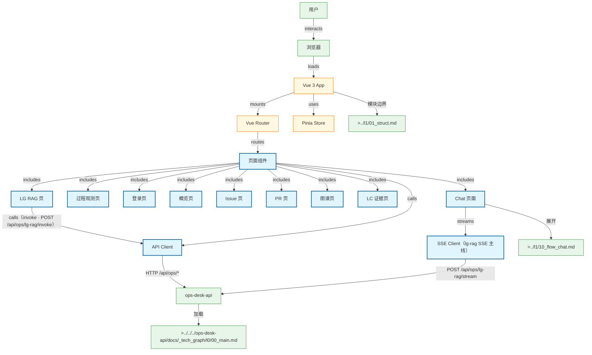

# ops-desk-web 顶层流程总图

Ops Desk Web 前端架构总图：页面路由、Pinia Store、API Client、lg-rag SSE 主线消费与后端 API 的关系。

## Mermaid

## Structured Data

### Nodes

| ID | Label | Kind |
|----|-------|------|
| user | 用户 | external |
| browser | 浏览器 | external |
| app | Vue 3 App | struct |
| router | Vue Router | struct |
| pinia | Pinia Store | struct |
| api_client | API Client | flow |
| sse_client | SSE Client（lg-rag SSE 主线） | flow |
| pages | 页面组件 | flow |
| chat_page | Chat 页面 | flow |
| obs_page | 过程观测页 | flow |
| login_page | 登录页 | flow |
| overview_page | 概览页 | flow |
| issues_page | Issue 页 | flow |
| pulls_page | PR 页 | flow |
| graph_page | 图谱页 | flow |
| lc_evidence_page | LC 证据页 | flow |
| lg_rag_page | LG RAG 页 | flow |
| chat_flow | >../l1/10_flow_chat.md | external |
| modules_doc | >../l1/01_struct.md | external |
| ops_api | ops-desk-api | external |
| api_doc | >../../../ops-desk-api/docs/_tech_graph/l0/00_main.md | external |

### Edges

| From | To | Mark | Type | Label | Anchors |
|------|----|------|------|-------|---------|
| user | browser | -> | depends_on | interacts |  |
| browser | app | -> | depends_on | loads |  |
| app | router | -> | depends_on | mounts |  |
| app | pinia | -> | depends_on | uses |  |
| router | pages | -> | depends_on | routes |  |
| pages | api_client | -> | depends_on | calls |  |
| pages | chat_page | -> | depends_on | includes |  |
| pages | obs_page | -> | depends_on | includes |  |
| pages | login_page | -> | depends_on | includes |  |
| pages | overview_page | -> | depends_on | includes |  |
| pages | issues_page | -> | depends_on | includes |  |
| pages | pulls_page | -> | depends_on | includes |  |
| pages | graph_page | -> | depends_on | includes |  |
| pages | lc_evidence_page | -> | depends_on | includes |  |
| pages | lg_rag_page | -> | depends_on | includes |  |
| lg_rag_page | api_client | -> | depends_on | calls（invoke · POST /api/ops/lg-rag/invoke） |  |
| chat_page | sse_client | -> | depends_on | streams |  |
| chat_page | chat_flow | -> | depends_on | 展开 |  |
| sse_client | ops_api | -> | depends_on | POST /api/ops/lg-rag/stream |  |
| api_client | ops_api | -> | depends_on | HTTP /api/ops/* |  |
| ops_api | api_doc | -> | depends_on | 加载 |  |
| app | modules_doc | -> | depends_on | 模块边界 |  |

## Sub-graph Links

- `Struct`: [`01_struct.md`](01_struct.md)（手写 · 无 `.graph.yaml`）
- `Version`: [`02_version.md`](02_version.md)（手写 · 无 `.graph.yaml`）
- 子图编辑源见 `docs/_tech_graph/*.graph.yaml`

