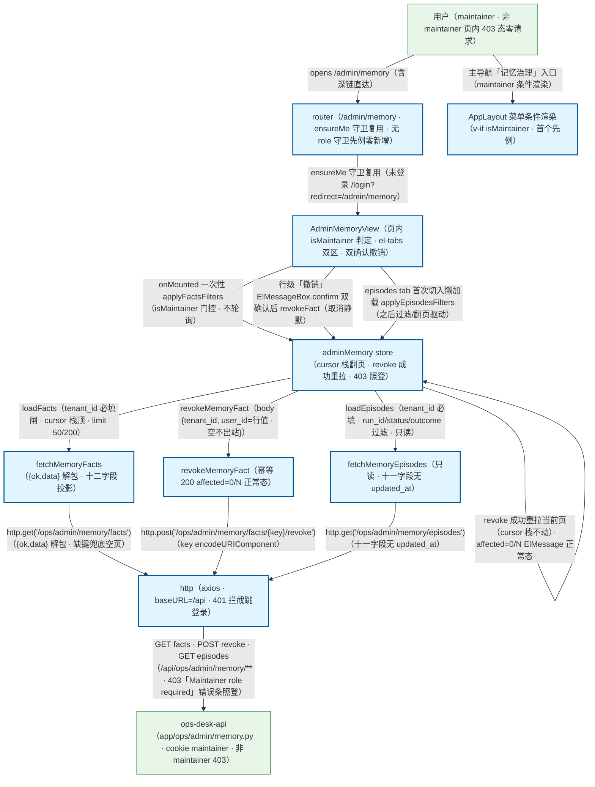

# admin memory 管理页浏览/撤销/历程流程（前端 · P3-T9 · task_web_p3_t9_admin_memory · 14 §4 D-D + 15 §5）

maintainer 打开记忆治理页（/admin/memory · AppLayout 菜单 maintainer 条件渲染 · 普通用户零探测面）：router ensureMe 守卫复用（未登录跳 /login?redirect=/admin/memory · 401 由 http 全局拦截器承接 · 仓内无 role 守卫先例故页内 isMaintainer 判定 · 深链直达非 maintainer 渲染 403 权限态不请求任何 admin 端点）→ onMounted 一次性 applyFactsFilters（不轮询）→ api/adminMemory → http axios → GET /api/ops/admin/memory/facts（tenant_id 必填 · status/kind 过滤 · limit 50/200 · keyset cursor 栈翻页无总数 · 十二字段投影无 embedding · 响应 {ok,data} 包裹壳 client 内解包）。撤销：行级「撤销」→ ElMessageBox.confirm 双确认 → POST /facts/{key}/revoke body {tenant_id, user_id=行值 · 空不出站} → 幂等 200 affected=0/N 皆正常态（ElMessage success/info · 非错误非 409）→ 成功重拉当前页。历程 episodes tab：首次切入懒加载（之后过滤/翻页驱动 · 不重复拉）→ GET /api/ops/admin/memory/episodes（tenant_id 必填 · run_id/status/outcome 过滤 · 十一字段只读无操作列）。旁注：①admin 面=跨租户运维面（R7 · maintainer 全局角色无租户绑定 · 非租户管理员）；②错误面 403「Maintainer role required」错误条（权限不足）/ 401 跳登录 / 词表外 422 由 select 固定词表规避 / tenant_id 空前端必填闸不触达上游 400；③本页零 SSE 零轮询。

## Mermaid

## Structured Data

### Nodes

| ID | Label | Kind |
|----|-------|------|
| user | 用户（maintainer · 非 maintainer 页内 403 态零请求） | external |
| router_guard | router（/admin/memory · ensureMe 守卫复用 · 无 role 守卫先例零新增） | flow |
| menu_gate | AppLayout 菜单条件渲染（v-if isMaintainer · 首个先例） | flow |
| memory_view | AdminMemoryView（页内 isMaintainer 判定 · el-tabs 双区 · 双确认撤销） | flow |
| memory_store | adminMemory store（cursor 栈翻页 · revoke 成功重拉 · 403 照登） | flow |
| facts_api | fetchMemoryFacts（{ok,data} 解包 · 十二字段投影） | flow |
| revoke_api | revokeMemoryFact（幂等 200 affected=0/N 正常态） | flow |
| episodes_api | fetchMemoryEpisodes（只读 · 十一字段无 updated_at） | flow |
| http_client | http（axios · baseURL=/api · 401 拦截跳登录） | flow |
| ops_api | ops-desk-api（app/ops/admin/memory.py · cookie maintainer · 非 maintainer 403） | external |

### Edges

| From | To | Mark | Type | Label | Anchors |
|------|----|------|------|-------|---------|
| user | menu_gate | -> | depends_on | 主导航「记忆治理」入口（maintainer 条件渲染） |  |
| user | router_guard | -> | depends_on | opens /admin/memory（含深链直达） |  |
| router_guard | memory_view | -> | depends_on | ensureMe 守卫复用（未登录 /login?redirect=/admin/memory） |  |
| memory_view | memory_store | -> | depends_on | onMounted 一次性 applyFactsFilters（isMaintainer 门控 · 不轮询） |  |
| memory_store | facts_api | -> | depends_on | loadFacts（tenant_id 必填闸 · cursor 栈顶 · limit 50/200） |  |
| facts_api | http_client | -> | depends_on | http.get('/ops/admin/memory/facts')（{ok,data} 解包 · 缺键兜底空页） |  |
| memory_view | memory_store | -> | depends_on | 行级「撤销」ElMessageBox.confirm 双确认后 revokeFact（取消静默） |  |
| memory_store | revoke_api | -> | depends_on | revokeMemoryFact（body {tenant_id, user_id=行值 · 空不出站}） |  |
| revoke_api | http_client | -> | depends_on | http.post('/ops/admin/memory/facts/{key}/revoke')（key encodeURIComponent） |  |
| memory_store | memory_store | -> | depends_on | revoke 成功重拉当前页（cursor 栈不动）· affected=0/N ElMessage 正常态 |  |
| memory_view | memory_store | -> | depends_on | episodes tab 首次切入懒加载 applyEpisodesFilters（之后过滤/翻页驱动） |  |
| memory_store | episodes_api | -> | depends_on | loadEpisodes（tenant_id 必填 · run_id/status/outcome 过滤 · 只读） |  |
| episodes_api | http_client | -> | depends_on | http.get('/ops/admin/memory/episodes')（十一字段无 updated_at） |  |
| http_client | ops_api | -> | depends_on | GET facts · POST revoke · GET episodes（/api/ops/admin/memory/** · 403「Maintainer role required」错误条照登） |  |
