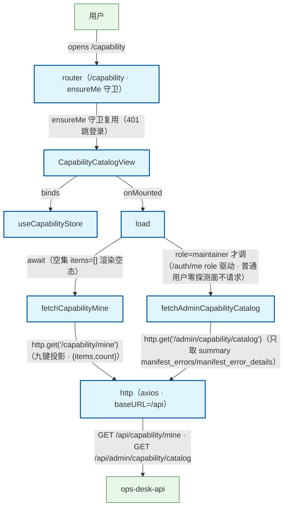

# Capability 目录页加载流程（前端 · T-W3 图谱先行 · 30 未开工 · 文件名为规划命名以 task_web_capability_catalog 为准）

用户打开目录页（/capability）：router ensureMe 守卫 → CapabilityCatalogView onMounted → useCapabilityStore.load → api/capability.fetchCapabilityMine → api/http axios → GET /api/capability/mine → ops_api（九键白名单投影 · 排除 adapter/args_schema · {items,count} 照登）。role=maintainer 时另走 fetchAdminCapabilityCatalog → GET /api/admin/capability/catalog（只取 summary 的 manifest_errors/manifest_error_details 渲染故障详情）；普通用户零探测面（菜单/路由/请求三级均不见 maintainer 信息 · 不请求 admin 端点）。旁注：①权限口径 cookie 会话 + /auth/me role 驱动显隐，非前端硬编码账号；②空集（items=[]）/ 故障态（manifest_errors 非空）/ 加载态三态渲染；③401 由 http 全局拦截器跳登录（复用既有）；④响应体 snake_case 原始体照登，字段级真值以 /openapi.json + 端点实际行为为准（FP-1）。

## Mermaid

## Structured Data

### Nodes

| ID | Label | Kind |
|----|-------|------|
| user | 用户 | external |
| router_guard | router（/capability · ensureMe 守卫） | flow |
| capability_view | CapabilityCatalogView | flow |
| capability_store | useCapabilityStore | flow |
| load_action | load | flow |
| fetch_mine_api | fetchCapabilityMine | flow |
| fetch_catalog_api | fetchAdminCapabilityCatalog | flow |
| http_client | http（axios · baseURL=/api） | flow |
| ops_api | ops-desk-api | external |

### Edges

| From | To | Mark | Type | Label | Anchors |
|------|----|------|------|-------|---------|
| user | router_guard | -> | depends_on | opens /capability |  |
| router_guard | capability_view | -> | depends_on | ensureMe 守卫复用（401 跳登录） |  |
| capability_view | capability_store | -> | depends_on | binds |  |
| capability_view | load_action | -> | depends_on | onMounted |  |
| load_action | fetch_mine_api | -> | depends_on | await（空集 items=[] 渲染空态） |  |
| fetch_mine_api | http_client | -> | depends_on | http.get('/capability/mine')（九键投影 · {items,count}） |  |
| load_action | fetch_catalog_api | -> | depends_on | role=maintainer 才调（/auth/me role 驱动 · 普通用户零探测面不请求） |  |
| fetch_catalog_api | http_client | -> | depends_on | http.get('/admin/capability/catalog')（只取 summary manifest_errors/manifest_error_details） |  |
| http_client | ops_api | -> | depends_on | GET /api/capability/mine · GET /api/admin/capability/catalog |  |
