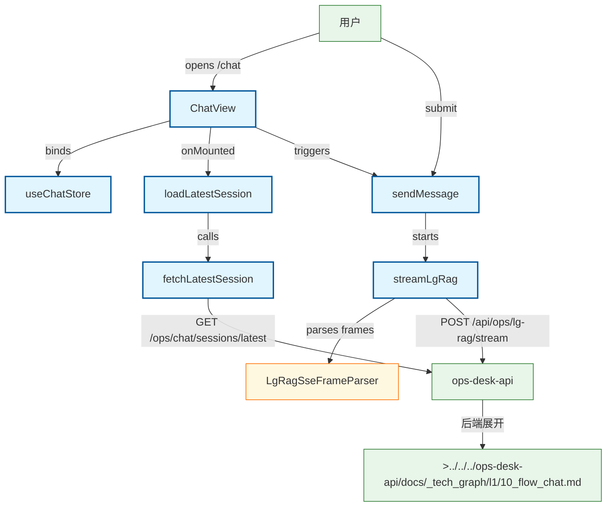

# Chat 流式对话流程（前端）

用户在 Chat 页发送消息：ChatView → chat store → useLgRagSse → POST /api/ops/lg-rag/stream（freeze lg-rag-sse-v1 · 2026-08-31 起主 Chat 切 lg-rag SSE，废弃 chat stream 主路径）；会话元数据走 axios fetchLatestSession（T2 保留门控，非 lg-rag SoT）。T3（2026-08-31）thread_id 会话连续性：客户端不自生成；首轮留空 → api 生成 → run.start payload 捕获；localStorage 持久化（key ops.lg-rag.thread-id，不可用则内存态降级）；刷新/重进恢复后端上下文（不回显历史消息，顶部提示条）；401/登出清除；已存 id 遇 404/422 清本地 id + 提示、不自动重发；startNewSession() 开新会话。

## Mermaid

## Structured Data

### Nodes

| ID | Label | Kind |
|----|-------|------|
| user | 用户 | external |
| chat_view | ChatView | flow |
| chat_store | useChatStore | flow |
| load_session | loadLatestSession | flow |
| send_message | sendMessage | flow |
| fetch_session_api | fetchLatestSession | flow |
| stream_sse | streamLgRag | flow |
| sse_parser | LgRagSseFrameParser | struct |
| ops_api | ops-desk-api | external |
| api_chat_flow | >../../../ops-desk-api/docs/_tech_graph/l1/10_flow_chat.md | external |

### Edges

| From | To | Mark | Type | Label | Anchors |
|------|----|------|------|-------|---------|
| user | chat_view | -> | depends_on | opens /chat |  |
| chat_view | chat_store | -> | depends_on | binds |  |
| chat_view | load_session | -> | depends_on | onMounted |  |
| load_session | fetch_session_api | -> | depends_on | calls |  |
| fetch_session_api | ops_api | -> | depends_on | GET /ops/chat/sessions/latest |  |
| user | send_message | -> | depends_on | submit |  |
| chat_view | send_message | -> | depends_on | triggers |  |
| send_message | stream_sse | -> | depends_on | starts |  |
| stream_sse | sse_parser | -> | depends_on | parses frames |  |
| stream_sse | ops_api | -> | depends_on | POST /api/ops/lg-rag/stream |  |
| ops_api | api_chat_flow | -> | depends_on | 后端展开 |  |
