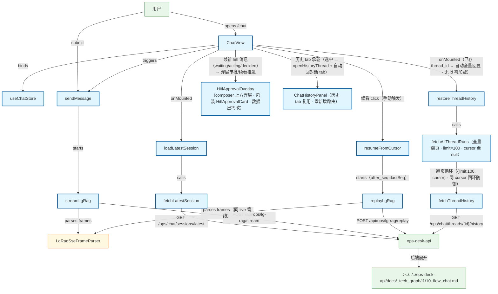

# Chat 流式对话流程（前端）

用户在 Chat 页发送消息：ChatView → chat store → useLgRagSse → POST /api/ops/lg-rag/stream（freeze lg-rag-sse-v1 · 2026-08-31 起主 Chat 切 lg-rag SSE，废弃 chat stream 主路径）；会话元数据走 axios fetchLatestSession（T2 保留门控，非 lg-rag SoT）。T3（2026-08-31）thread_id 会话连续性：客户端不自生成；首轮留空 → api 生成 → run.start payload 捕获；localStorage 持久化（key ops.lg-rag.thread-id，不可用则内存态降级）；刷新/重进恢复后端上下文并自动全量回显历史消息（restoreThreadHistory · fetchAllThreadRuns 翻页循环 limit=100 · cursor 至 null · 顶部提示条）；401/登出清除；已存 id 遇 404/422 清本地 id + 提示、不自动重发；startNewSession() 开新会话。T4（2026-08-31）断联/replay 续看：每帧捕获可选顶层 cursor（缺失以 run_id+seq 合成）；active-run 持久化（key ops.lg-rag.active-run，终态 done/error/abort 即清除）；断网/超时 mid-stream → 错误条 + 手动「续看」→ replayLgRag POST /api/ops/lg-rag/replay body {run_id, after_seq}（SSE 形状同 live，复用同一 LgRagSseFrameParser 与渲染管线，渲染进新建 assistant 消息）；per run_id 记 lastAppliedSeq，seq<=lastAppliedSeq 帧忽略（answer 不重复 append · thinking 不重复）；replay 404/422 清 active-run + 提示不重试；401（live/replay）清 thread_id + 清 active-run + 跳登录；replay 流再断 lastSeq 已推进可接力；刷新有未完成 run →「上次回答未完成·续看」条（不自动 replay）。T5（2026-08-31）answer delta 打字机：payload 含 delta 键 → 追加到当前 assistant.content；含 content 键 → 全量替换（终帧 final:true 同此 · 严禁终帧叠加到 delta 拼接后）；两键同帧 content 优先 + warn（R1-N1）；done/error/abort/传输层终断后停止追加（迟到帧忽略）；无 delta 帧自然降级 T2 整段行为；占位帧（content 空串 + note:no_aggregator）按 T2 现行为；replay 含 delta 复用同一 processFrame 管线；ChatView streaming 中最新 assistant 气泡光标态（最小 UI 增量）。T6（2026-08-31）chat SSE 死代码已清除：旧 chat SSE 封装与对照单测删除（api chat stream 已 410 Gone），静态守卫升级为「文件缺席 + src 全树无 chat stream 字面量」；保留 fetchLatestSession 会话元数据门控（api 端点未下线）。progressive-reveal（2026-09-08）：客户端 reveal 队列（useRevealQueue · 60 字/秒）——answer delta 先入网络缓冲再匀速出队到 content（同 tick 突发不瞬满）；content/final 取消队列并以终稿替换；done/error/abort 刷齐已收；subtask step 即时可读行；done 解析 subtask_result.output 打字机渐显；replay 默认 ≥4× 加速；双缓冲改写现有 content/subtasks[].content（少动 ChatView 绑定）。subtask-message（2026-09-08 · task web-lg-rag-sse-subtask-message）：subtask.progress 三态优先 payload.message——running/step 非空 message 原样即时上屏（running 零前缀，不再套「执行中 ·」叠句）；done 有 output 仍渐显 output（message 不得覆盖/截断/替代），无 output 时 message 显式优先作完成摘要（先于 summary/content）；空串视为缺省走本地兜底；node.progress 的 summarizeProgress 直出顺序不受影响。阶段 T（2026-09-18 · web-tenant-context-chat）：Chat 请求携带租户上下文——session 真源（F1=C）+ 请求头 X-Ops-Tenant-Id（axios 与 useLgRagSse fetch 同挂；credentials include）；顶栏切换 UI 写 POST /ops/auth/tenant 后再发下一问；不改 SSE event_type 解析表。chat-history-hitl-ux（2026-10-04 · task web-chat-history-hitl-ux · freeze lg-rag-sse-v1 只消费既有帧 · 传输/解析零改动 · 零新事件类型）：hitl.waiting 帧 → chat store 审批卡片态 → ChatView 消息流内联审批卡片（裁定 F-A · src/components/chat/HitlApprovalCard）；done 按 payload.status 分支——waiting_approval ≠ 完成态（保留 active-run 供审批后续看接力 · 不记 lastDone），completed/failed/无 status 维持现行清除；历史侧栏内嵌 ChatView（裁定 F-B · src/components/chat-history/ChatHistoryPanel）→ openHistoryThread → B1 GET /api/ops/chat/threads + /{thread_id}/history（src/api/chatHistory.ts 经 axios http）→ run 消息视图映射既有 ChatMessage 渲染（裁定 F-C）；waiting_approval thread 以 active-run 语义挂起（last_seq 契约未提供 → 0 从头 replay）· 续看复用 resumeFromCursor/replayLgRag（不新造机制）；审批动作链 B2（src/api/hitl.ts）POST /api/ops/hitl/requests/{id}/decide → 成功后 POST /resume（两步链 · decide 不自动 resume）+ fetchHitlPending 两消费点（动作后刷新 + 进入 waiting thread 一次性核对 · 不轮询）；B1/B2 404/501 → 降级文案不阻塞 Chat 主路径（FP-F8）。approval-overlay（2026-10-28 · task_web_hitl_approval_overlay_ux）：Chat 页审批动作面由消息流内联 HitlApprovalCard 迁移为 composer 上方浮层 HitlApprovalOverlay（包装同一 HitlApprovalCard · 数据层零改 · hitl.note 数据源不动 · 消息流仅留一行只读标记）；decided+canResume 浮层卡即 chase 续看推进落点（与顶部错误条共存层叠 · 窄屏层叠 · streaming 禁用随迁既有 card 逻辑）；历史已决 hitl 消息进浮层仅只读标记。resumeFromCursor 空 replay 回收：0 内容帧终帧（replay 端空 200 / done 仅元信息）→ 回收新建 assistant 气泡不渲染空气泡（D1 · 空流不吞 resumeHint）。restoreThreadHistory/openHistoryThread 共用 fetchAllThreadRuns 全量翻页（D11 · 服务端默认 20 截断消解 · 上限 100 内合规）；404→会话不存在或已过期 · 其余非 401→历史服务暂不可用（主路径不阻塞）。Chat 页内「对话|历史」双 tab 复用 ChatHistoryPanel 零新增路由（D13 · history-toggle 侧栏形态废止）；historyLoading 门控 composer（加载中禁用 · 加载后消息非空放弃覆盖 · D14 不双轨）。

## Mermaid

## Structured Data

### Nodes

| ID | Label | Kind |
|----|-------|------|
| user | 用户 | external |
| chat_view | ChatView | flow |
| chat_store | useChatStore | flow |
| load_session | loadLatestSession | flow |
| send_message | sendMessage | flow |
| fetch_session_api | fetchLatestSession | flow |
| stream_sse | streamLgRag | flow |
| replay_sse | replayLgRag | flow |
| resume_from_cursor | resumeFromCursor | flow |
| sse_parser | LgRagSseFrameParser | struct |
| ops_api | ops-desk-api | external |
| api_chat_flow | >../../../ops-desk-api/docs/_tech_graph/l1/10_flow_chat.md | external |
| restore_thread_history | restoreThreadHistory | flow |
| fetch_all_thread_runs | fetchAllThreadRuns（全量翻页 · limit=100 · cursor 至 null） | flow |
| thread_history_api | fetchThreadHistory | flow |
| hitl_overlay | HitlApprovalOverlay（composer 上方浮层 · 包装 HitlApprovalCard · 数据层零改） | flow |
| chat_history_panel | ChatHistoryPanel（历史 tab 复用 · 零新增路由） | flow |

### Edges

| From | To | Mark | Type | Label | Anchors |
|------|----|------|------|-------|---------|
| user | chat_view | -> | depends_on | opens /chat |  |
| chat_view | chat_store | -> | depends_on | binds |  |
| chat_view | load_session | -> | depends_on | onMounted |  |
| load_session | fetch_session_api | -> | depends_on | calls |  |
| fetch_session_api | ops_api | -> | depends_on | GET /ops/chat/sessions/latest |  |
| user | send_message | -> | depends_on | submit |  |
| chat_view | send_message | -> | depends_on | triggers |  |
| send_message | stream_sse | -> | depends_on | starts |  |
| stream_sse | sse_parser | -> | depends_on | parses frames |  |
| stream_sse | ops_api | -> | depends_on | POST /api/ops/lg-rag/stream |  |
| chat_view | resume_from_cursor | -> | depends_on | 续看 click（手动触发） |  |
| resume_from_cursor | replay_sse | -> | depends_on | starts（after_seq=lastSeq） |  |
| replay_sse | sse_parser | -> | depends_on | parses frames（同 live 管线） |  |
| replay_sse | ops_api | -> | depends_on | POST /api/ops/lg-rag/replay |  |
| ops_api | api_chat_flow | -> | depends_on | 后端展开 |  |
| chat_view | restore_thread_history | -> | depends_on | onMounted（已存 thread_id → 自动全量回显 · 无 id 零加载） |  |
| restore_thread_history | fetch_all_thread_runs | -> | depends_on | calls |  |
| fetch_all_thread_runs | thread_history_api | -> | depends_on | 翻页循环（{limit:100, cursor} · 同 cursor 回环防御） |  |
| thread_history_api | ops_api | -> | depends_on | GET /ops/chat/threads/{id}/history |  |
| chat_view | hitl_overlay | -> | depends_on | 最新 hitl 消息（waiting/acting/decided）→ 浮层审批/续看推进 |  |
| chat_view | chat_history_panel | -> | depends_on | 历史 tab 承载（选中 → openHistoryThread + 自动回对话 tab） |  |
