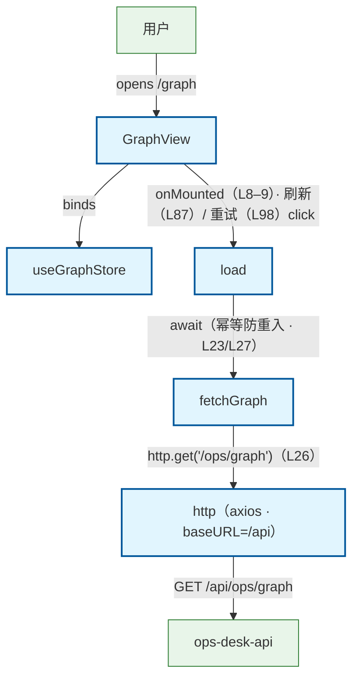

# Graph 图谱快照页加载流程（前端）

用户打开图谱页（/graph）：GraphView onMounted → useGraphStore.load → api/graph.fetchGraph → api/http axios → GET /api/ops/graph → ops_api。旁注：① 全 null 响应（无快照时后端实测 {snapshot:null, module_matrix:null, repo_id:null, created_at:null}）是正常数据态，不视为错误（api 头注 L7–8 · store 头注 L13）；module_matrix 结构未知按防御性渲染（类型宽松 unknown · api L10–17）；② load() 幂等防重入（store L23），loaded 标记是否成功加载过（store L20/L28）；③ 失败写 ApiError 供页面 el-alert + 重试（store L29–33 · view L98），「刷新」按钮同走 load（view L87）；④ store 另有 reset()（L37–42）清空三态，当前页未挂触发点，不入链。

## Mermaid

## Structured Data

### Nodes

| ID | Label | Kind |
|----|-------|------|
| user | 用户 | external |
| graph_view | GraphView | flow |
| graph_store | useGraphStore | flow |
| load_action | load | flow |
| fetch_graph_api | fetchGraph | flow |
| http_client | http（axios · baseURL=/api） | flow |
| ops_api | ops-desk-api | external |

### Edges

| From | To | Mark | Type | Label | Anchors |
|------|----|------|------|-------|---------|
| user | graph_view | -> | depends_on | opens /graph |  |
| graph_view | graph_store | -> | depends_on | binds |  |
| graph_view | load_action | -> | depends_on | onMounted（L8–9）· 刷新（L87）/ 重试（L98）click |  |
| load_action | fetch_graph_api | -> | depends_on | await（幂等防重入 · L23/L27） |  |
| fetch_graph_api | http_client | -> | depends_on | http.get('/ops/graph')（L26） |  |
| http_client | ops_api | -> | depends_on | GET /api/ops/graph |  |
