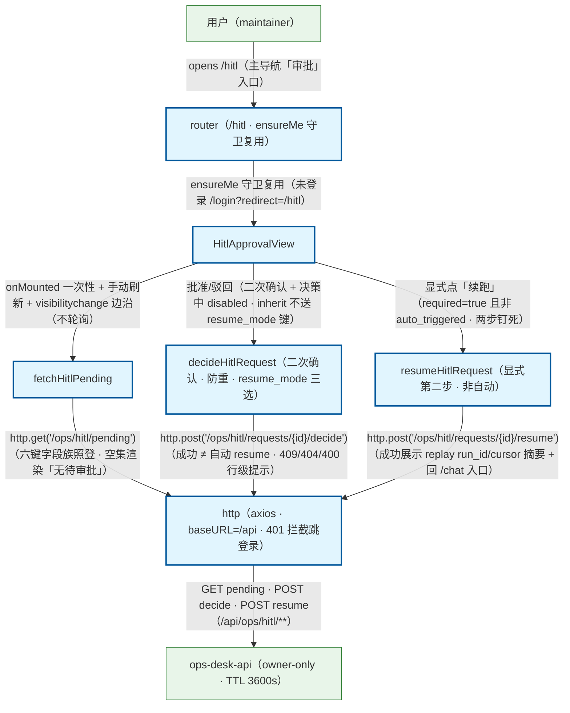

# 独立 HITL 审批页加载与决策流程（前端 · 第四审批入口 · task_web-hitl-approval-page）

用户打开审批页（/hitl）：router ensureMe 守卫（未登录跳 /login?redirect=/hitl · 401 由 http 全局拦截器承接）→ HitlApprovalView onMounted 一次性 fetchHitlPending（不轮询 · visibilitychange hidden→visible 边沿单次刷新 · 卸载移除监听）→ api/hitl → http axios → GET /api/ops/hitl/pending（仅本人 owner · 非 maintainer 403）。决策：批准/驳回二次确认 + 防重复提交 + resume_mode 三选（inherit 不送键 · 与 HitlApprovalCard 零分叉）→ POST decide（成功 ≠ 自动 resume · 两步钉死）；resume.required=true 且非 auto_triggered → 显式「续跑」→ POST resume；immediate 且 auto_triggered → 已自动续跑提示。「回到会话查看」仅跳 { name: 'chat' } 不携参。旁注：①冻结契约 src/api/hitl.ts 只消费禁改，字段族六键照登；②错误面 403 权限态 / 401 跳登录 / 409 已被处理 / 404 不存在 / 400 resume_mode 白名单 / TTL 3600s 过期行级提示；③本页不消费 replay 补帧（仅展示 run_id/cursor 摘要，补帧属 Chat 页既有机制）。Chat 页侧（2026-10-28 · task_web_hitl_approval_overlay_ux）：Chat 页审批动作面由消息流内联迁移为 composer 上方浮层 HitlApprovalOverlay（包装同一 HitlApprovalCard · decide/resume_mode 字段语义与本页零分叉 · 数据层 hitl.note 数据源不动）；本页（/hitl）存续不受影响。

## Mermaid

## Structured Data

### Nodes

| ID | Label | Kind |
|----|-------|------|
| user | 用户（maintainer） | external |
| router_guard | router（/hitl · ensureMe 守卫复用） | flow |
| hitl_view | HitlApprovalView | flow |
| fetch_pending_api | fetchHitlPending | flow |
| decide_api | decideHitlRequest（二次确认 · 防重 · resume_mode 三选） | flow |
| resume_api | resumeHitlRequest（显式第二步 · 非自动） | flow |
| http_client | http（axios · baseURL=/api · 401 拦截跳登录） | flow |
| ops_api | ops-desk-api（owner-only · TTL 3600s） | external |

### Edges

| From | To | Mark | Type | Label | Anchors |
|------|----|------|------|-------|---------|
| user | router_guard | -> | depends_on | opens /hitl（主导航「审批」入口） |  |
| router_guard | hitl_view | -> | depends_on | ensureMe 守卫复用（未登录 /login?redirect=/hitl） |  |
| hitl_view | fetch_pending_api | -> | depends_on | onMounted 一次性 + 手动刷新 + visibilitychange 边沿（不轮询） |  |
| fetch_pending_api | http_client | -> | depends_on | http.get('/ops/hitl/pending')（六键字段族照登 · 空集渲染「无待审批」） |  |
| hitl_view | decide_api | -> | depends_on | 批准/驳回（二次确认 + 决策中 disabled · inherit 不送 resume_mode 键） |  |
| decide_api | http_client | -> | depends_on | http.post('/ops/hitl/requests/{id}/decide')（成功 ≠ 自动 resume · 409/404/400 行级提示） |  |
| hitl_view | resume_api | -> | depends_on | 显式点「续跑」（required=true 且非 auto_triggered · 两步钉死） |  |
| resume_api | http_client | -> | depends_on | http.post('/ops/hitl/requests/{id}/resume')（成功展示 replay run_id/cursor 摘要 + 回 /chat 入口） |  |
| http_client | ops_api | -> | depends_on | GET pending · POST decide · POST resume（/api/ops/hitl/**） |  |
