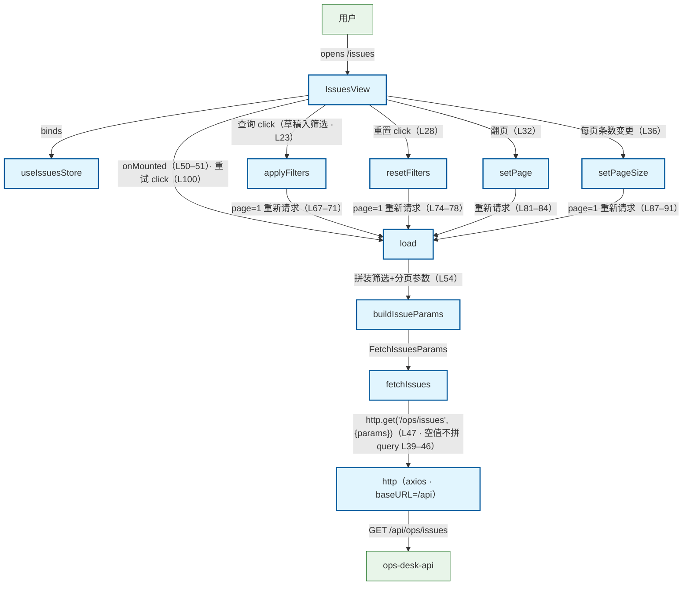

# Issues 列表页查询流程（前端）

用户打开 Issues 页（/issues）：IssuesView onMounted → useIssuesStore.load → buildIssueParams 拼装参数 → api/issues.fetchIssues → api/http axios → GET /api/ops/issues → ops_api。旁注：① 筛选表单是草稿态，点「查询」才 applyFilters（部分更新 + page 重置 1 重新请求 · store L67–71 · view L19–23）；resetFilters 全量重置（store L74–78）；setPage/setPageSize 分页切换重新请求（pageSize 变更同重置 page=1 · store L81–91）；② 空字符串/undefined 筛选参数不拼进 query（api L39–46 · buildIssueParams 纯函数 store L21–32）；③ 后端按 updated_at desc 固定排序，前端不做排序（api 头注 L6）；④ 请求失败不抛异常，写 error 供 el-alert + 重试（store L59–63 · view L100）。

## Mermaid

## Structured Data

### Nodes

| ID | Label | Kind |
|----|-------|------|
| user | 用户 | external |
| issues_view | IssuesView | flow |
| issues_store | useIssuesStore | flow |
| load_action | load | flow |
| apply_filters | applyFilters | flow |
| reset_filters | resetFilters | flow |
| set_page | setPage | flow |
| set_page_size | setPageSize | flow |
| build_issue_params | buildIssueParams | flow |
| fetch_issues_api | fetchIssues | flow |
| http_client | http（axios · baseURL=/api） | flow |
| ops_api | ops-desk-api | external |

### Edges

| From | To | Mark | Type | Label | Anchors |
|------|----|------|------|-------|---------|
| user | issues_view | -> | depends_on | opens /issues |  |
| issues_view | issues_store | -> | depends_on | binds |  |
| issues_view | load_action | -> | depends_on | onMounted（L50–51）· 重试 click（L100） |  |
| issues_view | apply_filters | -> | depends_on | 查询 click（草稿入筛选 · L23） |  |
| issues_view | reset_filters | -> | depends_on | 重置 click（L28） |  |
| issues_view | set_page | -> | depends_on | 翻页（L32） |  |
| issues_view | set_page_size | -> | depends_on | 每页条数变更（L36） |  |
| apply_filters | load_action | -> | depends_on | page=1 重新请求（L67–71） |  |
| reset_filters | load_action | -> | depends_on | page=1 重新请求（L74–78） |  |
| set_page | load_action | -> | depends_on | 重新请求（L81–84） |  |
| set_page_size | load_action | -> | depends_on | page=1 重新请求（L87–91） |  |
| load_action | build_issue_params | -> | depends_on | 拼装筛选+分页参数（L54） |  |
| build_issue_params | fetch_issues_api | -> | depends_on | FetchIssuesParams |  |
| fetch_issues_api | http_client | -> | depends_on | http.get('/ops/issues', {params})（L47 · 空值不拼 query L39–46） |  |
| http_client | ops_api | -> | depends_on | GET /api/ops/issues |  |
