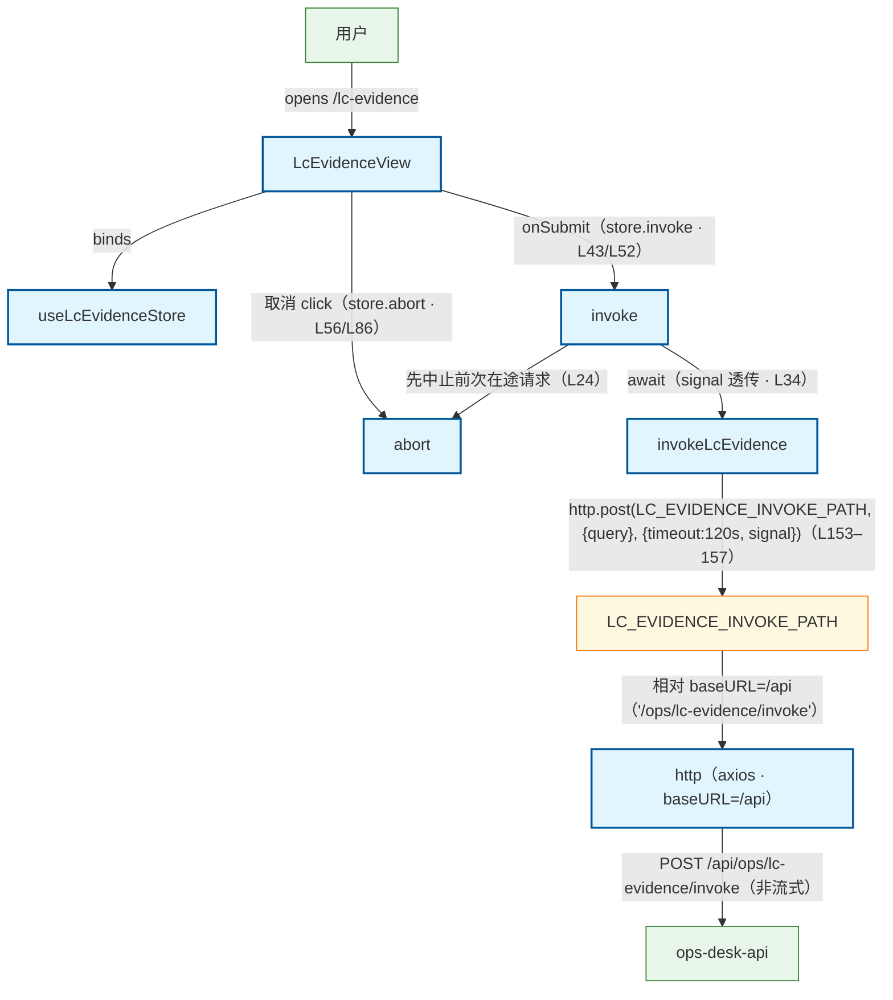

# LC Evidence 旁路 invoke 流程（前端）

用户在 LC Evidence 旁路实验页（/lc-evidence）提交 query：LcEvidenceView → useLcEvidenceStore.invoke → api/lcEvidence.invokeLcEvidence → api/http axios → POST /api/ops/lc-evidence/invoke → ops_api。旁注：① gate_action=refuse 为 200 成功态，写入 result 而非 error（store 头注 L9 · view isRefuse L21 互证）；② 响应为 {ok,data} 信封，仅 api 层拆封（unwrapEnvelope L135–142 · 其余接口直取无外壳）；③ 非流式（freeze lc-evidence-http-v1 · api L27 注）；④ 单次超时 120s 落在 invokeLcEvidence 请求 config（LC_EVIDENCE_TIMEOUT_MS L6 · L156），不改 http 全局 30s；⑤ 404/502 统一文案「旁路 API 不可用」（LC_EVIDENCE_UNAVAILABLE_MESSAGE L11 · mapLcEvidenceError L108–118），500 兼容 FastAPI detail 与 {ok:false,error}；⑥ 取消（abort/新 invoke 抢占）不写 error（isCanceledError L87–95 · store L36–38）。

## Mermaid

## Structured Data

### Nodes

| ID | Label | Kind |
|----|-------|------|
| user | 用户 | external |
| lc_evidence_view | LcEvidenceView | flow |
| lc_evidence_store | useLcEvidenceStore | flow |
| invoke_action | invoke | flow |
| abort_action | abort | flow |
| invoke_api | invokeLcEvidence | flow |
| invoke_path | LC_EVIDENCE_INVOKE_PATH | struct |
| http_client | http（axios · baseURL=/api） | flow |
| ops_api | ops-desk-api | external |

### Edges

| From | To | Mark | Type | Label | Anchors |
|------|----|------|------|-------|---------|
| user | lc_evidence_view | -> | depends_on | opens /lc-evidence |  |
| lc_evidence_view | lc_evidence_store | -> | depends_on | binds |  |
| lc_evidence_view | invoke_action | -> | depends_on | onSubmit（store.invoke · L43/L52） |  |
| invoke_action | abort_action | -> | depends_on | 先中止前次在途请求（L24） |  |
| invoke_action | invoke_api | -> | depends_on | await（signal 透传 · L34） |  |
| invoke_api | invoke_path | -> | depends_on | http.post(LC_EVIDENCE_INVOKE_PATH, {query}, {timeout:120s, signal})（L153–157） |  |
| invoke_path | http_client | -> | depends_on | 相对 baseURL=/api（'/ops/lc-evidence/invoke'） |  |
| http_client | ops_api | -> | depends_on | POST /api/ops/lc-evidence/invoke（非流式） |  |
| lc_evidence_view | abort_action | -> | depends_on | 取消 click（store.abort · L56/L86） |  |
