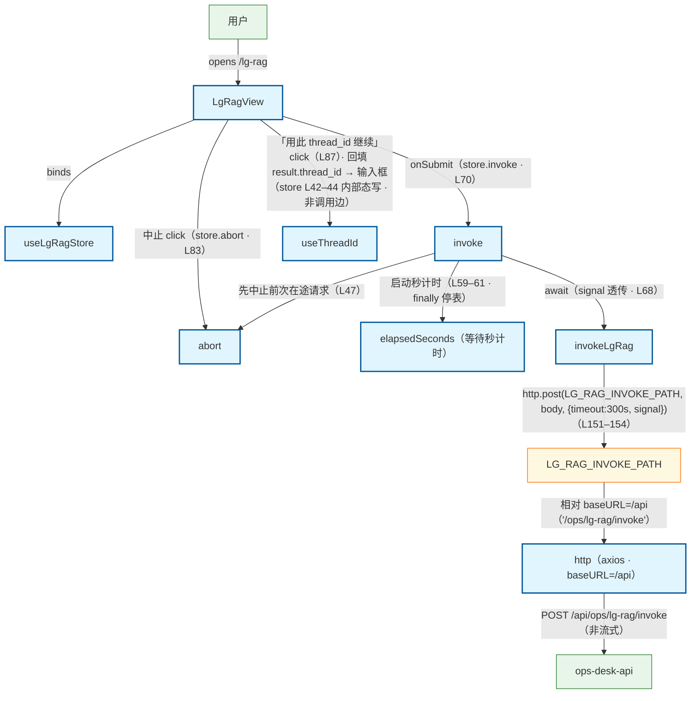

# LG RAG 旁路 invoke 流程（前端）

用户在 LG RAG 旁路实验页（/lg-rag）提交 query：LgRagView → useLgRagStore.invoke → api/lgRag.invokeLgRag → api/http axios → POST /api/ops/lg-rag/invoke → ops_api。旁注：① route=refuse / gate_action=refuse 为 200 成功态（lgRag.ts L141 · store L15 · view isRefuse L19–23 三处互证），写入 result 而非 error；② 非流式（freeze lg-rag-http-v1 · lgRag.ts L139），SSE 主线在 10_flow_chat 不重复建模；③ thread_id 续写回填：「用此 thread_id 继续」把响应 result.thread_id 回填输入框（store useThreadId L42–44 · 进程内有效），invoke 时非空 thread_id 入请求体（store L64–65）；④ mode 三档 router / basic / supervisor（lgRag.ts L13 LgRagMode）；⑤ 单次超时 300s 落在 invokeLgRag 请求 config（LG_RAG_TIMEOUT_MS L6 · L152），不改 http 全局 30s；⑥ 404/502 统一文案「旁路 API 不可用」（mapLgRagError L106–116）；取消（abort/新 invoke 抢占）不写 error（isCanceledError L85–93 · store L70–72）；elapsedSeconds 为 loading 期间秒计时（store L25 声明 · L59–61 setInterval · finally 停表）。

## Mermaid

## Structured Data

### Nodes

| ID | Label | Kind |
|----|-------|------|
| user | 用户 | external |
| lg_rag_view | LgRagView | flow |
| lg_rag_store | useLgRagStore | flow |
| invoke_action | invoke | flow |
| abort_action | abort | flow |
| use_thread_id | useThreadId | flow |
| elapsed_timer | elapsedSeconds（等待秒计时） | flow |
| invoke_api | invokeLgRag | flow |
| invoke_path | LG_RAG_INVOKE_PATH | struct |
| http_client | http（axios · baseURL=/api） | flow |
| ops_api | ops-desk-api | external |

### Edges

| From | To | Mark | Type | Label | Anchors |
|------|----|------|------|-------|---------|
| user | lg_rag_view | -> | depends_on | opens /lg-rag |  |
| lg_rag_view | lg_rag_store | -> | depends_on | binds |  |
| lg_rag_view | invoke_action | -> | depends_on | onSubmit（store.invoke · L70） |  |
| invoke_action | abort_action | -> | depends_on | 先中止前次在途请求（L47） |  |
| invoke_action | elapsed_timer | -> | depends_on | 启动秒计时（L59–61 · finally 停表） |  |
| invoke_action | invoke_api | -> | depends_on | await（signal 透传 · L68） |  |
| invoke_api | invoke_path | -> | depends_on | http.post(LG_RAG_INVOKE_PATH, body, {timeout:300s, signal})（L151–154） |  |
| invoke_path | http_client | -> | depends_on | 相对 baseURL=/api（'/ops/lg-rag/invoke'） |  |
| http_client | ops_api | -> | depends_on | POST /api/ops/lg-rag/invoke（非流式） |  |
| lg_rag_view | abort_action | -> | depends_on | 中止 click（store.abort · L83） |  |
| lg_rag_view | use_thread_id | -> | depends_on | 「用此 thread_id 继续」click（L87）· 回填 result.thread_id → 输入框（store L42–44 内部态写 · 非调用边） |  |
