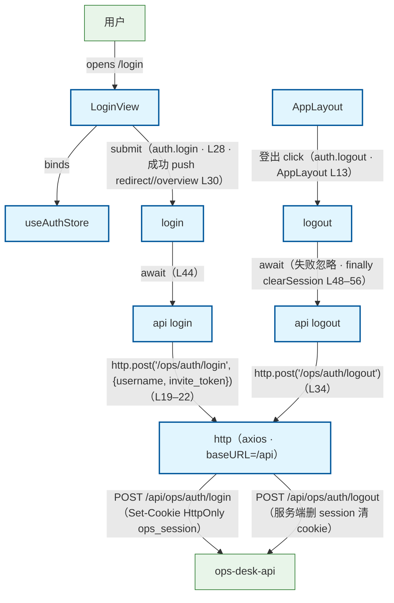

# Login 登录 / 登出流程（前端）

用户在登录页（/login）提交用户名 + 邀请密钥：LoginView → useAuthStore.login → api/auth.login → api/http axios → POST /api/ops/auth/login → ops_api；登出由 AppLayout 触发：useAuthStore.logout → api/auth.logout → POST /api/ops/auth/logout。旁注：① 会话为 HttpOnly cookie（ops_session · 成功时后端 Set-Cookie 写入，api L17），前端不接触 token；② login 请求自身的 401（凭证错误）交给表单展示，不触发全局跳转（http.ts L65–67）；③ 登出请求失败也忽略——本地登出语义永远成立，finally 必 clearSession（store L48–56）；clearSession 同步清 lg-rag thread_id / active-run 本地持久化，防换账号串号（store L59–71）；④ 路由守卫联动：beforeEach 首导航 await ensureMe 会话探测（401=未登录缓存结论 · store L23–41 · router/index.ts L88–100），未登录跳 /login?redirect=<原路径>、已登录访 /login 回 /overview；http 401 拦截经 setUnauthorizedHandler 注册回调 → clearSession + 跳登录（router/index.ts L107–114）；⑤ 登录成功 router.push 回 redirect 或 /overview（view L28–30）。

## Mermaid

## Structured Data

### Nodes

| ID | Label | Kind |
|----|-------|------|
| user | 用户 | external |
| login_view | LoginView | flow |
| app_layout | AppLayout | flow |
| auth_store | useAuthStore | flow |
| login_action | login | flow |
| logout_action | logout | flow |
| login_api | api login | flow |
| logout_api | api logout | flow |
| http_client | http（axios · baseURL=/api） | flow |
| ops_api | ops-desk-api | external |

### Edges

| From | To | Mark | Type | Label | Anchors |
|------|----|------|------|-------|---------|
| user | login_view | -> | depends_on | opens /login |  |
| login_view | auth_store | -> | depends_on | binds |  |
| login_view | login_action | -> | depends_on | submit（auth.login · L28 · 成功 push redirect//overview L30） |  |
| login_action | login_api | -> | depends_on | await（L44） |  |
| login_api | http_client | -> | depends_on | http.post('/ops/auth/login', {username, invite_token})（L19–22） |  |
| http_client | ops_api | -> | depends_on | POST /api/ops/auth/login（Set-Cookie HttpOnly ops_session） |  |
| app_layout | logout_action | -> | depends_on | 登出 click（auth.logout · AppLayout L13） |  |
| logout_action | logout_api | -> | depends_on | await（失败忽略 · finally clearSession L48–56） |  |
| logout_api | http_client | -> | depends_on | http.post('/ops/auth/logout')（L34） |  |
| http_client | ops_api | -> | depends_on | POST /api/ops/auth/logout（服务端删 session 清 cookie） |  |
