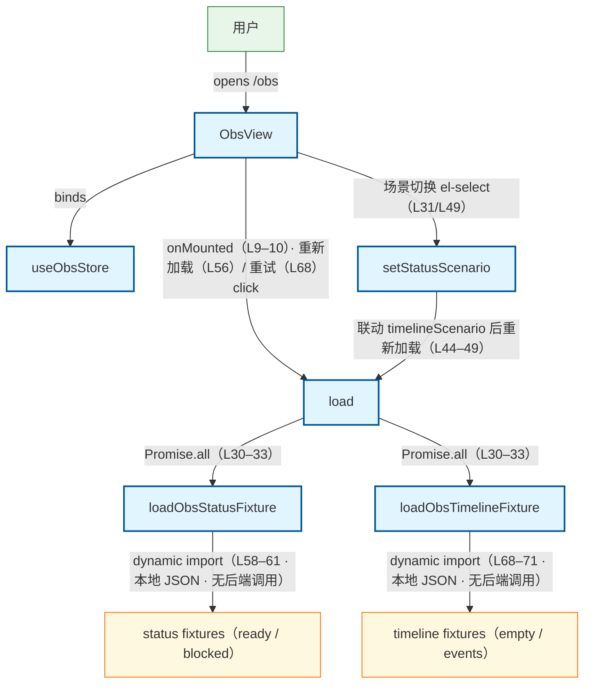

# Obs 过程可观测页加载流程（前端 · fixture 驱动）

用户打开可观测页（/obs）：ObsView onMounted → useObsStore.load → api/obs.loadObsStatusFixture + loadObsTimelineFixture（Promise.all）→ 动态 import 本地 JSON fixture。**本地 fixture 驱动 · 无后端调用**（实证链止于 fixture：无 http/ops_api 段 · R1-N2）。旁注：① 只读契约对齐 dsh-coding-kit obs_status.v1 / obs_timeline.v1，本棒仅从 fixture 加载、禁止在浏览器执行 npx（api 头注 L1–4）；② fixture 场景切换：status ready/blocked（ObsStatusScenario · api L50）× timeline empty/events（api L53），setStatusScenario 语义联动——满闸配 events、阻塞配 empty（store L44–49 · view el-select L31/L49）；③ 加载失败不抛未捕获异常，error 写字符串供 el-alert + 重试（store L36–41 · view L60–68）；④ 数据源为 src/fixtures/obs/ 四个 JSON（status_ready/status_blocked/timeline_empty/timeline_events · dynamic import api L58–61/L68–71）。

## Mermaid

## Structured Data

### Nodes

| ID | Label | Kind |
|----|-------|------|
| user | 用户 | external |
| obs_view | ObsView | flow |
| obs_store | useObsStore | flow |
| load_action | load | flow |
| set_status_scenario | setStatusScenario | flow |
| load_status_fixture | loadObsStatusFixture | flow |
| load_timeline_fixture | loadObsTimelineFixture | flow |
| status_fixtures | status fixtures（ready / blocked） | struct |
| timeline_fixtures | timeline fixtures（empty / events） | struct |

### Edges

| From | To | Mark | Type | Label | Anchors |
|------|----|------|------|-------|---------|
| user | obs_view | -> | depends_on | opens /obs |  |
| obs_view | obs_store | -> | depends_on | binds |  |
| obs_view | load_action | -> | depends_on | onMounted（L9–10）· 重新加载（L56）/ 重试（L68）click |  |
| obs_view | set_status_scenario | -> | depends_on | 场景切换 el-select（L31/L49） |  |
| set_status_scenario | load_action | -> | depends_on | 联动 timelineScenario 后重新加载（L44–49） |  |
| load_action | load_status_fixture | -> | depends_on | Promise.all（L30–33） |  |
| load_action | load_timeline_fixture | -> | depends_on | Promise.all（L30–33） |  |
| load_status_fixture | status_fixtures | -> | depends_on | dynamic import（L58–61 · 本地 JSON · 无后端调用） |  |
| load_timeline_fixture | timeline_fixtures | -> | depends_on | dynamic import（L68–71 · 本地 JSON · 无后端调用） |  |
