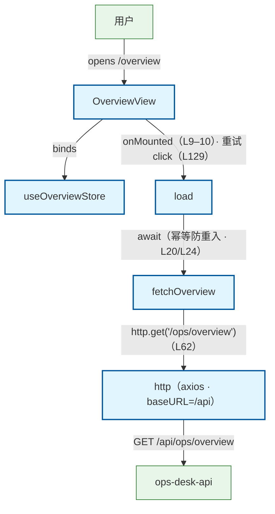

# Overview 总览页加载流程（前端）

用户打开总览页（/overview）：OverviewView onMounted → useOverviewStore.load → api/overview.fetchOverview → api/http axios → GET /api/ops/overview → ops_api。旁注：① load() 幂等防重入——进行中的请求未完成前重复调用直接返回（store L20）；② 失败不污染已有数据——保留上一次成功 data，error 供页面 el-alert + 「重试」（store 头注 L11–12 · view L121–129）；③ 后端 dev 库为空属正常返回：median_days=null / sync_run=null / trend 全 0，页面按空态渲染（api 头注 L7–9 · MedianMetric L12–16 / TrendPoint L39–44 类型在案）；④ 401 由 http 全局拦截器处理跳登录（api L60 注 · http.ts L60–71）。

## Mermaid

## Structured Data

### Nodes

| ID | Label | Kind |
|----|-------|------|
| user | 用户 | external |
| overview_view | OverviewView | flow |
| overview_store | useOverviewStore | flow |
| load_action | load | flow |
| fetch_overview_api | fetchOverview | flow |
| http_client | http（axios · baseURL=/api） | flow |
| ops_api | ops-desk-api | external |

### Edges

| From | To | Mark | Type | Label | Anchors |
|------|----|------|------|-------|---------|
| user | overview_view | -> | depends_on | opens /overview |  |
| overview_view | overview_store | -> | depends_on | binds |  |
| overview_view | load_action | -> | depends_on | onMounted（L9–10）· 重试 click（L129） |  |
| load_action | fetch_overview_api | -> | depends_on | await（幂等防重入 · L20/L24） |  |
| fetch_overview_api | http_client | -> | depends_on | http.get('/ops/overview')（L62） |  |
| http_client | ops_api | -> | depends_on | GET /api/ops/overview |  |
