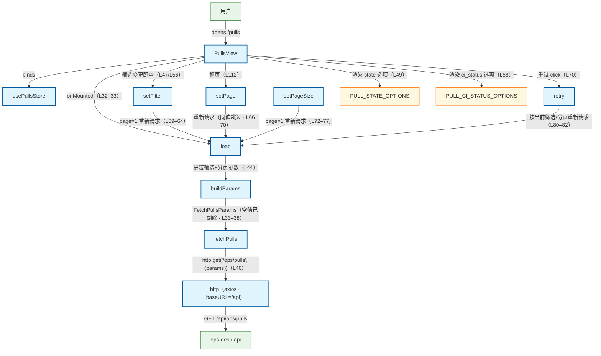

# Pull Requests 列表页查询流程（前端）

用户打开 PR 页（/pulls）：PullsView onMounted → usePullsStore.load → buildParams 拼装参数 → api/pulls.fetchPulls → api/http axios → GET /api/ops/pulls → ops_api。旁注：① 筛选即改即查——setFilter 变更 state/ci_status 直接 page=1 重新请求（store L59–64 · view el-select L47/L56），选项来自可配置常量 PULL_STATE_OPTIONS（open/closed/merged · api L33）与 PULL_CI_STATUS_OPTIONS（success/failure/pending · api L36 · view L49/L58 渲染）；② setPage/setPageSize 与当前值相同则直接返回不重打（store L66–77）；③ 空值筛选参数拼装时剔除（buildParams store L33–38 · api 头注 L38）；④ 错误态清空 items/total 并写 error，「重试」走 retry → load（store L50–53/L80–82 · view L70）。

## Mermaid

## Structured Data

### Nodes

| ID | Label | Kind |
|----|-------|------|
| user | 用户 | external |
| pulls_view | PullsView | flow |
| pulls_store | usePullsStore | flow |
| load_action | load | flow |
| set_filter | setFilter | flow |
| set_page | setPage | flow |
| set_page_size | setPageSize | flow |
| retry_action | retry | flow |
| build_params | buildParams | flow |
| pull_state_options | PULL_STATE_OPTIONS | struct |
| pull_ci_status_options | PULL_CI_STATUS_OPTIONS | struct |
| fetch_pulls_api | fetchPulls | flow |
| http_client | http（axios · baseURL=/api） | flow |
| ops_api | ops-desk-api | external |

### Edges

| From | To | Mark | Type | Label | Anchors |
|------|----|------|------|-------|---------|
| user | pulls_view | -> | depends_on | opens /pulls |  |
| pulls_view | pulls_store | -> | depends_on | binds |  |
| pulls_view | load_action | -> | depends_on | onMounted（L32–33） |  |
| pulls_view | pull_state_options | -> | depends_on | 渲染 state 选项（L49） |  |
| pulls_view | pull_ci_status_options | -> | depends_on | 渲染 ci_status 选项（L58） |  |
| pulls_view | set_filter | -> | depends_on | 筛选变更即查（L47/L56） |  |
| pulls_view | set_page | -> | depends_on | 翻页（L112） |  |
| pulls_view | retry_action | -> | depends_on | 重试 click（L70） |  |
| set_filter | load_action | -> | depends_on | page=1 重新请求（L59–64） |  |
| set_page | load_action | -> | depends_on | 重新请求（同值跳过 · L66–70） |  |
| set_page_size | load_action | -> | depends_on | page=1 重新请求（L72–77） |  |
| retry_action | load_action | -> | depends_on | 按当前筛选/分页重新请求（L80–82） |  |
| load_action | build_params | -> | depends_on | 拼装筛选+分页参数（L44） |  |
| build_params | fetch_pulls_api | -> | depends_on | FetchPullsParams（空值已剔除 · L33–38） |  |
| fetch_pulls_api | http_client | -> | depends_on | http.get('/ops/pulls', {params})（L40） |  |
| http_client | ops_api | -> | depends_on | GET /api/ops/pulls |  |
